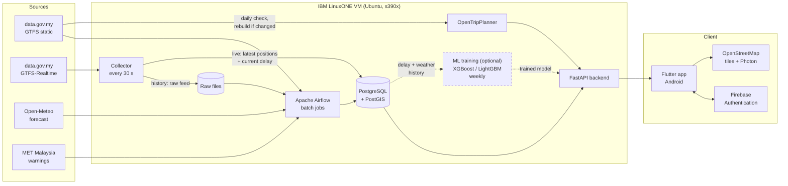
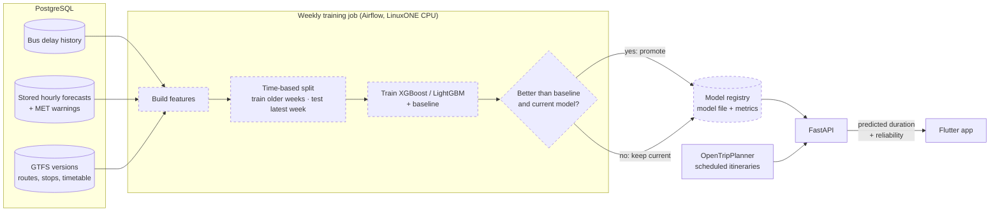

# MoveKL

**Weather-aware public transport trip planning for Kuala Lumpur, built on an open data engineering pipeline.**

MoveKL shows commuters in the Klang Valley how to get from A to B by bus, LRT, MRT, Monorail or KTM, and tells them whether rain or an official weather warning will affect *that* journey at *that* time. Behind the app is an automated pipeline that collects, cleans and validates Malaysian open transport data and weather data, and builds a history that can be used to measure and predict bus delays.

> 🚧 **Status: early development.** Final Year Project (FYP) at Universiti Tenaga Nasional (UNITEN), Malaysia, 2026–2027. The design is complete and the repository is being built up component by component — see [Roadmap](#roadmap).

---

## Why

Existing apps (Google Maps, Moovit, MyRapid PULSE) show routes and live buses, but the weather they show, if any, is for the map area right now — not for the commuter's specific route and travel time. Kuala Lumpur's heavy afternoon storms and flash floods regularly disrupt commuting, and there is no journey-specific view of that risk.

MoveKL links three things together:

1. **Routes** across all Klang Valley rail and Rapid KL bus services
2. **Weather along the journey** — hourly rain forecast for the time you'll actually be travelling, plus official MET Malaysia warnings
3. **Bus reliability** — live delay status, calculated from real-time bus positions against the timetable

## Features

**Mobile app**
- Map of your location, nearby stops and live bus positions (OpenStreetMap)
- Journey search, e.g. *UNITEN → KLCC*, with route options drawn on the map
- Travel time, live bus delay status, rain expected during the trip, active MET warnings
- Guest-first: plan trips without an account
- Optional account (email or Google Sign-In) to save places (Home, Work, custom) and see trip history

**Data pipeline (the core of the project)**
- Continuous collector for GTFS-Realtime bus positions (every 30 s, matching the feed's update rate), with a live path for the app and a raw history path for the pipeline
- GTFS static timetables, stops and route shapes stored in PostgreSQL, checked daily and reloaded only when the feed changes, with every version kept
- Scheduled ingestion of hourly weather forecasts and MET warnings
- Cleaning, validation and data quality reporting
- Live delay for each bus, calculated as positions arrive by projecting them onto GTFS route shapes; hourly delay statistics for history
- Raw data kept unchanged so everything downstream can be rebuilt

**Optional: machine learning**
- Predict bus delay and route reliability from weather and historical delays, trained on the LinuxONE server and compared against OpenTripPlanner's scheduled times — see [Optional: machine learning](#optional-machine-learning)

## Architecture



*Dashed box and arrows = optional machine learning component.*

| Job | Frequency |
|---|---|
| **Live path:** collect GTFS-Realtime bus positions, update latest positions and current delay per bus in PostgreSQL | every 30 s (continuous collector, not Airflow) |
| **History path:** save each raw feed response unchanged as a file | every 30 s (same collector) |
| Process raw files: decode, clean, validate, load into history tables | every 15 min |
| MET Malaysia warnings (deduplicated) | every 15 min |
| Open-Meteo hourly forecast | hourly |
| Historical delay statistics (positions vs timetable, per route / stop / hour) | hourly |
| GTFS static: check for a new feed version; validate and load only if changed | daily |
| Data quality report | daily |
| Rebuild OpenTripPlanner graph | whenever a new GTFS version is loaded |
| *(Optional)* Retrain and evaluate ML model | weekly |

**Two paths, one collector.** Airflow is a batch scheduler and is not used for anything that needs to be live. The collector runs on its own as a systemd service: every 30 seconds it updates a small `latest_vehicle_positions` table (each bus's newest position and current delay), so live buses in the app are at most about 30 seconds old. At the same time it saves the raw response unchanged; Airflow processes those files every 15 minutes into the history tables used for statistics, data quality reports and ML. Because the raw files are never modified, the history can always be rebuilt if a cleaning step changes.

The mobile app never calls data.gov.my directly — everything goes through the backend. The collector stays within the data.gov.my rate limit (4 requests/minute per API) by staggering the feed requests across each 30-second cycle and backing off when it receives HTTP 429.

## GTFS static data and versioning

All GTFS static data (stops, routes, trips, stop times, calendars, shapes) is stored in PostgreSQL. The app gets station locations, stop search results and route details from the MoveKL backend, which reads PostgreSQL, so user activity never adds requests to data.gov.my. The pipeline downloads each GTFS feed once a day, no matter how many people use the app.

**Daily update check (Airflow)**

1. Download each operator's GTFS zip and compute its SHA-256 hash.
2. If the hash matches the current version, stop — nothing changed.
3. If it is different, register a new **feed version** and load the files into **staging tables**.
4. Run validation checks on staging: required files and columns present, stops inside the Klang Valley bounding box, no duplicate stop coordinates, contiguous `shape_pt_sequence`, every trip's `shape_id` and `service_id` exists.
5. If validation passes, mark the new version as **active** (the previous version stays in the database) and rebuild the OpenTripPlanner graph. If it fails, keep the current version and flag the failure in the data quality report.
6. Record what changed between versions: stops added, removed or moved; routes and trips added or removed.

**Version tables**

| Table | Purpose |
|---|---|
| `gtfs_feed_version` | One row per downloaded feed version: operator, hash, downloaded at, validated, active from / to |
| `gtfs_*` (stops, routes, trips, stop_times, calendar, calendar_dates, shapes) | GTFS data, each row tagged with its `feed_version_id` |
| `gtfs_change_log` | Differences between consecutive versions (added / removed / moved stops, added / removed routes and trips) |

Old versions are kept because historical bus delays were calculated against the timetable that was active at the time, which matters for reprocessing data and for training delay models. The original zip files are also kept unchanged in raw storage, so any version can be reloaded.

## Optional: machine learning

If time allows in FYP2, MoveKL adds a model that predicts how late a bus journey is likely to be, given the weather. It is trained on the same IBM LinuxONE server, using the history the pipeline has collected. The rest of the system does not depend on it: OpenTripPlanner stays the routing engine and the fallback.



**What it predicts**

| Output | Type | Shown in the app as |
|---|---|---|
| Expected delay (minutes) for each bus leg | Regression | Predicted journey time next to the scheduled time |
| Probability the leg is more than 5 minutes late | Classification | Reliability: high / medium / low |

**Features**

- **Route and stop:** route, direction, stop, position along the route, scheduled headway
- **Time:** hour of day, day of week, public or school holiday
- **Weather:** forecast rainfall and rain probability for the hour of travel, active MET warning
- **Recent conditions:** average delay on the same route in the last hour

The model is trained on the *forecasts* that were stored at the time, not on actual weather, because the app only has forecasts when a user plans a trip. This keeps training and prediction consistent.

**Models and evaluation**

- **Baseline:** historical average delay for the same route, hour and day type.
- **Models:** XGBoost or LightGBM gradient-boosted trees, chosen because the data is tabular and they train quickly on CPU.
- **Evaluation:** MAE and RMSE for delay minutes, F1 and ROC-AUC for the late / not-late class, compared against the baseline and against OpenTripPlanner's scheduled times. The split is by time, never random, so the model is always tested on weeks it has not seen.
- **Promotion:** a new model replaces the current one only if it scores better on the latest test week.

**Training on LinuxONE**

- Runs weekly as an Airflow DAG on the server's CPUs; no GPU is needed for this data size.
- Each trained model is saved with its metrics, training date range, feature list and the GTFS feed versions it was trained on, in a `ml_model_version` table, so any result can be traced and reproduced.
- XGBoost and LightGBM may need to be built from source on s390x; IBM Snap ML is an s390x-native alternative. Results will be documented in `docs/s390x.md`.

**Serving**

FastAPI loads the active model at startup. For each bus leg in an OpenTripPlanner itinerary it fills `predicted_duration_min` and `reliability` in the API response. These fields are nullable: with no model, the app simply shows the scheduled times.

## Tech stack

| Layer | Tools |
|---|---|
| Data pipeline | Python, Apache Airflow, PostgreSQL, PostGIS |
| Routing | OpenTripPlanner |
| Backend | FastAPI, Firebase Admin (token verification) |
| Mobile app | Flutter (Android), flutter_bloc (Cubit), flutter_map |
| Auth | Firebase Authentication (email/password, Google) |
| Maps & search | OpenStreetMap tiles, Photon, PostgreSQL `pg_trgm` for stop search |
| Machine learning (optional) | scikit-learn, XGBoost / LightGBM |
| Deployment | IBM LinuxONE virtual server (Ubuntu 24.04 LTS, s390x), services managed by systemd |

## Data sources

| Source | Data |
|---|---|
| [data.gov.my](https://developer.data.gov.my/) GTFS static | Prasarana (LRT, MRT, Monorail, Rapid KL bus) and KTMB timetables, stops and route shapes |
| [data.gov.my](https://developer.data.gov.my/) GTFS-Realtime | Vehicle positions for Rapid KL bus, MRT feeder bus and KTMB (no real-time feed for LRT/MRT/Monorail) |
| [Open-Meteo](https://open-meteo.com/) | Hourly weather forecast and historical archive |
| MET Malaysia via data.gov.my | Official weather warnings |
| [OpenStreetMap](https://www.openstreetmap.org/) | Street network for walking routes, map tiles, place search |

## Repository structure

```
fyp/
├── fyproject_app/  # Flutter mobile app (Android)
├── pipeline/
│   ├── collector/  # Continuous GTFS-Realtime collector
│   ├── dags/       # Airflow DAGs
│   └── sql/        # Database schema and migrations
├── backend/        # FastAPI service
├── otp/            # OpenTripPlanner config and graph build scripts
├── ml/             # Optional delay / reliability models
├── deploy/         # LinuxONE setup scripts and systemd service files
└── docs/           # Architecture, data dictionary, s390x notes
```

*Folders are added as each component is built.*

## Getting started

### Mobile app

Requirements: Flutter SDK, Android Studio or an Android device.

```bash
git clone https://github.com/HaidarAlAttas/fyp.git
cd fyp/fyproject_app
flutter pub get
flutter run
```

### Server stack

*Coming soon* — the pipeline, backend and OpenTripPlanner run directly on an IBM LinuxONE virtual server (Ubuntu, s390x). Each component is installed natively and runs as a systemd service:

```bash
cp .env.example .env              # add your API keys / Firebase credentials
sudo ./deploy/setup.sh            # install PostgreSQL/PostGIS, Python, Java, Airflow, OTP
sudo systemctl enable --now movekl-collector movekl-api otp airflow-scheduler airflow-webserver
```

## Running on IBM LinuxONE (s390x)

The whole server side of MoveKL runs on a single IBM LinuxONE virtual server (s390x architecture). Every component is installed natively and kept running 24/7 by systemd, which restarts any service that stops:

| Component | How it runs on LinuxONE |
|---|---|
| PostgreSQL + PostGIS | Ubuntu packages |
| Collector | Python service (`movekl-collector`) |
| Apache Airflow | Installed with pip in a Python virtual environment; scheduler and web UI as services |
| OpenTripPlanner | Shaded JAR on an s390x JDK (Eclipse Temurin) |
| FastAPI backend | Uvicorn service (`movekl-api`) behind HTTPS |
| ML libraries | Tested for s390x availability; built from source where needed |

Notes will be published in [`docs/s390x.md`](docs/s390x.md).

## Roadmap

- [x] Requirements, use cases and system architecture
- [x] UI design (Figma)
- [x] Flutter project set up
- [ ] GTFS-Realtime collector running 24/7 on LinuxONE
- [ ] PostgreSQL schema and versioned GTFS static ingestion (daily change check)
- [ ] Airflow DAGs: weather, warnings, cleaning, validation, data quality report
- [ ] Live delay per bus (collector) and hourly historical delay statistics (Airflow)
- [ ] OpenTripPlanner deployment for the Klang Valley
- [ ] FastAPI backend (journeys, weather, warnings, saved places)
- [ ] Flutter app: map, journey search, route details, weather, accounts
- [ ] s390x deployment notes
- [ ] (Optional) ML delay / reliability prediction, trained weekly on LinuxONE

## Out of scope

Ticketing and payments · real-time LRT/MRT/Monorail delays · turn-by-turn navigation · iOS release.

## Privacy

Accounts are optional. For registered users MoveKL stores only email, name and saved places, and users can delete their account at any time, in line with Malaysia's Personal Data Protection Act 2010 (PDPA).

## Attribution

- Map data © [OpenStreetMap contributors](https://www.openstreetmap.org/copyright)
- Transport data: [data.gov.my](https://data.gov.my/), Prasarana Malaysia Berhad and KTMB
- Weather data by [Open-Meteo.com](https://open-meteo.com/)
- Weather warnings: Malaysian Meteorological Department (MET Malaysia)
- Routing by [OpenTripPlanner](https://www.opentripplanner.org/)

## Author

**Syed Haidar Alattas** — Software Engineering, Universiti Tenaga Nasional (UNITEN)
Final Year Project, 2026–2027

## License

Released under the [MIT License](LICENSE).
