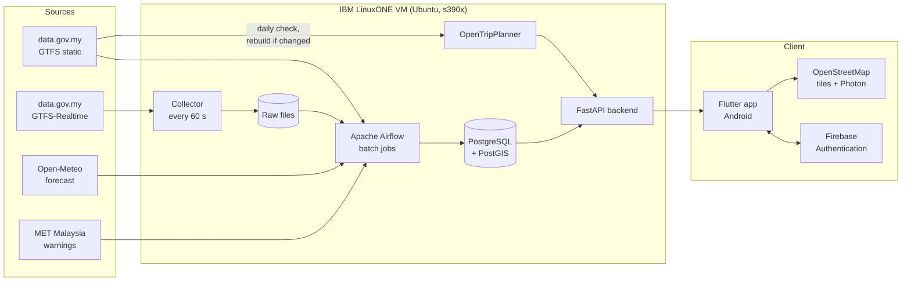

# MoveKL

**Weather-aware public transport trip planning for Kuala Lumpur, built on an open data engineering pipeline.**

MoveKL shows commuters in the Klang Valley how to get from A to B by bus, LRT, MRT, Monorail or KTM, and tells them whether rain or an official weather warning will affect *that* journey at *that* time. Behind the app is an automated pipeline that collects, cleans and validates Malaysian open transport data and weather data, and builds a history that can be used to measure and predict bus delays.

> 🚧 **Status: early development.** Final Year Project (FYP) at Universiti Tenaga Nasional (UNITEN), Malaysia, 2026–2027. The design is complete and the repository is being built up component by component — see [Roadmap](#roadmap).

---

## Why

Existing apps (Google Maps, Moovit, MyRapid PULSE) show routes and live buses, but the weather they show, if any, is for the map area right now — not for the commuter's specific route and travel time. Kuala Lumpur's heavy afternoon storms and flash floods regularly disrupt commuting, and there is no journey-specific view of that risk.

MoveKL links three things together:

1. **Routes** across all Klang Valley rail and Rapid KL bus services
2. **Weather along the journey** — hourly rain forecast for the time you'll actually be travelling, plus official MET Malaysia warnings
3. **Bus reliability** — live delay status, calculated from real-time bus positions against the timetable

## Features

**Mobile app**
- Map of your location, nearby stops and live bus positions (OpenStreetMap)
- Journey search, e.g. *UNITEN → KLCC*, with route options drawn on the map
- Travel time, live bus delay status, rain expected during the trip, active MET warnings
- Guest-first: plan trips without an account
- Optional account (email or Google Sign-In) to save places (Home, Work, custom) and see trip history

**Data pipeline (the core of the project)**
- Continuous collector for GTFS-Realtime bus positions (every 60 s)
- GTFS static timetables, stops and route shapes stored in PostgreSQL, checked daily and reloaded only when the feed changes, with every version kept
- Scheduled ingestion of hourly weather forecasts and MET warnings
- Cleaning, validation and data quality reporting
- Bus delay calculation by projecting live positions onto GTFS route shapes
- Raw data kept unchanged so everything downstream can be rebuilt

**Optional: machine learning**
- Predict journey delay / route reliability from weather and historical delays, evaluated against OpenTripPlanner's scheduled times

## Architecture



| Job | Frequency |
|---|---|
| Collect GTFS-Realtime bus positions → raw files | every 60 s (continuous collector, not Airflow) |
| Process raw positions: decode, clean, validate, load | every 15 min |
| MET Malaysia warnings (deduplicated) | every 15 min |
| Open-Meteo hourly forecast | hourly |
| Bus delay calculation (positions vs timetable) | hourly |
| GTFS static: check for a new feed version; validate and load only if changed | daily |
| Data quality report | daily |
| Rebuild OpenTripPlanner graph | whenever a new GTFS version is loaded |

The mobile app never calls data.gov.my directly — everything goes through the backend, which keeps within the data.gov.my rate limit (4 requests/minute per API).

## GTFS static data and versioning

All GTFS static data (stops, routes, trips, stop times, calendars, shapes) is stored in PostgreSQL. The app gets station locations, stop search results and route details from the MoveKL backend, which reads PostgreSQL, so user activity never adds requests to data.gov.my. The pipeline downloads each GTFS feed once a day, no matter how many people use the app.

**Daily update check (Airflow)**

1. Download each operator's GTFS zip and compute its SHA-256 hash.
2. If the hash matches the current version, stop — nothing changed.
3. If it is different, register a new **feed version** and load the files into **staging tables**.
4. Run validation checks on staging: required files and columns present, stops inside the Klang Valley bounding box, no duplicate stop coordinates, contiguous `shape_pt_sequence`, every trip's `shape_id` and `service_id` exists.
5. If validation passes, mark the new version as **active** (the previous version stays in the database) and rebuild the OpenTripPlanner graph. If it fails, keep the current version and flag the failure in the data quality report.
6. Record what changed between versions: stops added, removed or moved; routes and trips added or removed.

**Version tables**

| Table | Purpose |
|---|---|
| `gtfs_feed_version` | One row per downloaded feed version: operator, hash, downloaded at, validated, active from / to |
| `gtfs_*` (stops, routes, trips, stop_times, calendar, calendar_dates, shapes) | GTFS data, each row tagged with its `feed_version_id` |
| `gtfs_change_log` | Differences between consecutive versions (added / removed / moved stops, added / removed routes and trips) |

Old versions are kept because historical bus delays were calculated against the timetable that was active at the time, which matters for reprocessing data and for training delay models. The original zip files are also kept unchanged in raw storage, so any version can be reloaded.

## Tech stack

| Layer | Tools |
|---|---|
| Data pipeline | Python, Apache Airflow, PostgreSQL, PostGIS |
| Routing | OpenTripPlanner |
| Backend | FastAPI, Firebase Admin (token verification) |
| Mobile app | Flutter (Android), flutter_bloc (Cubit), flutter_map |
| Auth | Firebase Authentication (email/password, Google) |
| Maps & search | OpenStreetMap tiles, Photon, PostgreSQL `pg_trgm` for stop search |
| Machine learning (optional) | scikit-learn, XGBoost / LightGBM |
| Deployment | IBM LinuxONE virtual server (Ubuntu 24.04 LTS, s390x), services managed by systemd |

## Data sources

| Source | Data |
|---|---|
| [data.gov.my](https://developer.data.gov.my/) GTFS static | Prasarana (LRT, MRT, Monorail, Rapid KL bus) and KTMB timetables, stops and route shapes |
| [data.gov.my](https://developer.data.gov.my/) GTFS-Realtime | Vehicle positions for Rapid KL bus, MRT feeder bus and KTMB (no real-time feed for LRT/MRT/Monorail) |
| [Open-Meteo](https://open-meteo.com/) | Hourly weather forecast and historical archive |
| MET Malaysia via data.gov.my | Official weather warnings |
| [OpenStreetMap](https://www.openstreetmap.org/) | Street network for walking routes, map tiles, place search |

## Repository structure

```
fyp/
├── fyproject_app/  # Flutter mobile app (Android)
├── pipeline/
│   ├── collector/  # Continuous GTFS-Realtime collector
│   ├── dags/       # Airflow DAGs
│   └── sql/        # Database schema and migrations
├── backend/        # FastAPI service
├── otp/            # OpenTripPlanner config and graph build scripts
├── ml/             # Optional delay / reliability models
├── deploy/         # LinuxONE setup scripts and systemd service files
└── docs/           # Architecture, data dictionary, s390x notes
```

*Folders are added as each component is built.*

## Getting started

### Mobile app

Requirements: Flutter SDK, Android Studio or an Android device.

```bash
git clone https://github.com/HaidarAlAttas/fyp.git
cd fyp/fyproject_app
flutter pub get
flutter run
```

### Server stack

*Coming soon* — the pipeline, backend and OpenTripPlanner run directly on an IBM LinuxONE virtual server (Ubuntu, s390x). Each component is installed natively and runs as a systemd service:

```bash
cp .env.example .env              # add your API keys / Firebase credentials
sudo ./deploy/setup.sh            # install PostgreSQL/PostGIS, Python, Java, Airflow, OTP
sudo systemctl enable --now movekl-collector movekl-api otp airflow-scheduler airflow-webserver
```

## Running on IBM LinuxONE (s390x)

The whole server side of MoveKL runs on a single IBM LinuxONE virtual server (s390x architecture). Every component is installed natively and kept running 24/7 by systemd, which restarts any service that stops:

| Component | How it runs on LinuxONE |
|---|---|
| PostgreSQL + PostGIS | Ubuntu packages |
| Collector | Python service (`movekl-collector`) |
| Apache Airflow | Installed with pip in a Python virtual environment; scheduler and web UI as services |
| OpenTripPlanner | Shaded JAR on an s390x JDK (Eclipse Temurin) |
| FastAPI backend | Uvicorn service (`movekl-api`) behind HTTPS |
| ML libraries | Tested for s390x availability; built from source where needed |

Notes will be published in [`docs/s390x.md`](docs/s390x.md).

## Roadmap

- [x] Requirements, use cases and system architecture
- [x] UI design (Figma)
- [x] Flutter project set up
- [ ] GTFS-Realtime collector running 24/7 on LinuxONE
- [ ] PostgreSQL schema and versioned GTFS static ingestion (daily change check)
- [ ] Airflow DAGs: weather, warnings, cleaning, validation, data quality report
- [ ] Bus delay calculation
- [ ] OpenTripPlanner deployment for the Klang Valley
- [ ] FastAPI backend (journeys, weather, warnings, saved places)
- [ ] Flutter app: map, journey search, route details, weather, accounts
- [ ] s390x deployment notes
- [ ] (Optional) ML delay / reliability prediction

## Out of scope

Ticketing and payments · real-time LRT/MRT/Monorail delays · turn-by-turn navigation · iOS release.

## Privacy

Accounts are optional. For registered users MoveKL stores only email, name and saved places, and users can delete their account at any time, in line with Malaysia's Personal Data Protection Act 2010 (PDPA).

## Attribution

- Map data © [OpenStreetMap contributors](https://www.openstreetmap.org/copyright)
- Transport data: [data.gov.my](https://data.gov.my/), Prasarana Malaysia Berhad and KTMB
- Weather data by [Open-Meteo.com](https://open-meteo.com/)
- Weather warnings: Malaysian Meteorological Department (MET Malaysia)
- Routing by [OpenTripPlanner](https://www.opentripplanner.org/)

## Author

**Syed Haidar Alattas** — Software Engineering, Universiti Tenaga Nasional (UNITEN)
Final Year Project, 2026–2027

## License

Released under the [MIT License](LICENSE).
